<picture>
<source media="(max-width: 600px)" srcset="assets/interests-mobile.svg">

</picture>

  

  <picture>
    <source media="(max-width: 600px)" srcset="assets/about-mobile.svg">
    
  </picture>

  

  

  <picture>
    <source media="(max-width: 600px)" srcset="assets/stats-mobile.svg">
    
  </picture>
  
  <picture>
    <source media="(max-width: 600px)" srcset="assets/languages-mobile.svg">
    
  </picture>

  

  <picture>
    <source media="(max-width: 600px)" srcset="assets/setup-mobile.svg">
    
  </picture>

  

